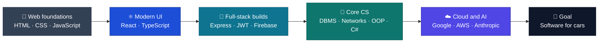
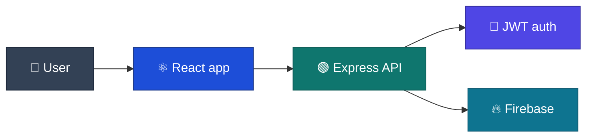

 

Think &nbsp;→&nbsp; Design &nbsp;→&nbsp; Build &nbsp;→&nbsp; Test &nbsp;→&nbsp; Ship

<table width="100%">
<tr>
<td width="64%" valign="middle">

RECRUITER SIGNAL BRIEF · reuelm07

<strong>Software Engineering Student</strong> · Passionate about problem solving · Interested in building software for cars · Focused on modern UI development

<strong>● Building and sharing work in public</strong>

</td>
<td width="36%" valign="middle" align="center">

 

 

</td>
</tr>
</table>

<h2>What teams can evaluate quickly</h2>

<table width="100%">
<tr>
<td width="25%" valign="top"><h3>🎯 Role fit</h3>
Frontend or full-stack engineer TypeScript · JavaScript · React · CSS
</td>
<td width="25%" valign="top"><h3>💜 C# &amp; .NET</h3>
Object-oriented programming, data structures and problem solving in C#
</td>
<td width="25%" valign="top"><h3>🧩 LeetCode</h3>
Regular algorithm and data-structure practice
</td>
<td width="25%" valign="top"><h3>⚡ Momentum</h3>
102 contributions · 28 active days 20 public repositories
</td>
</tr>
<tr>
<td width="25%" valign="top"><h3>🎮 Google Arcade 2026</h3>
75+ points and skill badges April to December 2026
</td>
<td width="25%" valign="top"><h3>🏅 Credentials</h3>
7 certifications and programs in cloud, AI, security and open source
</td>
<td width="25%" valign="top"><h3>🧠 CS fundamentals</h3>
DBMS · Computer Networks · Object-Oriented Programming
</td>
<td width="25%" valign="top"><h3>🗂️ Team tools</h3>
Jira · Balsamiq · n8n · Git · Figma
</td>
</tr>
</table>

<h2>About</h2>

I'm a Software Engineering student (B.E., Chitkara University, Deakin pathway) who enjoys turning ideas into clean, usable products. I like solving problems, building polished interfaces, and I'm especially interested in <strong>software for cars</strong> and automotive technology. Alongside web development, I write <strong>C#</strong>, practise algorithms on <strong>LeetCode</strong>, and keep learning cloud, AI and security through certifications and the <strong>Google Arcade</strong> program.

<table width="100%">
<tr>
<td width="25%" align="center">🎨 <strong>Frontend</strong> React · TypeScript · CSS</td>
<td width="25%" align="center">🧱 <strong>Full-Stack</strong> Node · Express · Firebase · JWT</td>
<td width="25%" align="center">💜 <strong>C# / .NET</strong> OOP · logic · problem solving</td>
<td width="25%" align="center">🚗 <strong>Automotive</strong> Software for cars</td>
</tr>
</table>

<h3>How my skills fit together</h3>

<h3>Pick your path (click to expand)</h3>

<strong>👔 I'm a recruiter: give me the 30-second summary</strong>

 

- **Role:** Frontend or full-stack engineer, also strong in C#
- **Stack:** React, TypeScript, JavaScript, CSS, Node.js, Express, Firebase, C#/.NET
- **Core CS:** DBMS, Computer Networks and Object-Oriented Programming
- **Evidence:** 20 public repositories, 102 contributions across 28 active days, and a series of full-stack DEV@Deakin projects with authentication and deployment
- **Credentials:** Google AI Essentials, AWS Cloud Essentials, Anthropic 101, LinkedIn Generative AI, Cisco Cybersecurity, TCS iON Young Professional, and GirlScript Summer of Code contributor
- **Learning in public:** Google Arcade 2026 participant with 75+ points and skill badges
- **Fundamentals:** regular LeetCode practice for data structures and algorithms
- **Looking for:** internships and junior roles in frontend, full-stack or C#/.NET development
- **Best way to reach me:** the LinkedIn button at the top of this page

<strong>👩‍💻 I'm an engineer: show me the stack and the flagship project</strong>

 

My most complete project is **DEV@Deakin: Subscription Management**, built with React, Express, JWT authentication and Firebase.

Source: [TASK-D1 on GitHub](https://github.com/REUELM07/TASK-D1)

<strong>🚗 I'm into automotive: what are you aiming for?</strong>

 

I want to combine my **UI skills** with **software for cars**. C# and C++ give me the typed, object-oriented fundamentals, and my frontend work gives me an eye for clear, usable interfaces. Automotive and in-vehicle software is the direction I'm building towards.

<h2>Find me online</h2>

<table width="100%">
<tr>
<td width="25%" align="center" valign="top">
  

 Professional profile and connections
</td>
<td width="25%" align="center" valign="top">
  

 Code, projects and contributions
</td>
<td width="25%" align="center" valign="top">
  

 Algorithms and problem solving
</td>
<td width="25%" align="center" valign="top">
  

 Life beyond the code
</td>
</tr>
</table>

<h2>Proof at a glance</h2>

<table width="100%">
<tr>
<td width="25%" align="center"><strong>20</strong> Repositories</td>
<td width="25%" align="center"><strong>102</strong> Contributions</td>
<td width="25%" align="center"><strong>28</strong> Active days</td>
<td width="25%" align="center"><strong>5</strong> Languages used</td>
</tr>
</table>

<picture>
  <source media="(prefers-color-scheme: light)" srcset="https://www.gitskins.com/api/section/stats?username=reuelm07&theme=github-dark&avatar=https%3A%2F%2Favatars.githubusercontent.com%2Fu%2F230436599%3Fu%3Dd14009b43c538204da3ada18d5c87c2411b0c398%26v%3D4&v=recruiter-stats-1&mode=light" />
  
</picture>

<h2>Technical toolkit</h2>

<h3 align="center">Languages</h3>

  

<h3 align="center">Frameworks, Backend &amp; Tools</h3>

  

<h3 align="center">Skills by area</h3>

<table width="100%">
<tr>
<td width="25%" valign="top" align="center">
 
<strong>🎨 Frontend</strong>  
 
 
 
 

</td>
<td width="25%" valign="top" align="center">
 
<strong>🧱 Backend</strong>  
 
 
 

</td>
<td width="25%" valign="top" align="center">
 
<strong>💜 C# &amp; Systems</strong>  
 
 
 

</td>
<td width="25%" valign="top" align="center">
 
<strong>🛠️ Dev tools</strong>  
 
 
 
 

</td>
</tr>
</table>

<table width="100%">
<tr>
<td width="33%" valign="top" align="center">
 
<strong>🧠 CS fundamentals</strong>  
 
 
 

</td>
<td width="33%" valign="top" align="center">
 
<strong>📋 Planning, design &amp; automation</strong>  
 
 
 

</td>
<td width="33%" valign="top" align="center">
 
<strong>☁️ Cloud, AI &amp; security</strong>  
 
 
 

</td>
</tr>
</table>

HTML5 · CSS3 · JavaScript · TypeScript · C# · C++ · React · Node.js · Express · Firebase · JWT · .NET · Git · GitHub · VS Code · Visual Studio Community · PyCharm · Jira · Balsamiq · n8n · Figma · Postman · Cisco Packet Tracer · DBMS · Computer Networks · OOP

<picture>
  <source media="(prefers-color-scheme: light)" srcset="https://www.gitskins.com/api/section/stack?username=reuelm07&theme=github-dark&avatar=https%3A%2F%2Favatars.githubusercontent.com%2Fu%2F230436599%3Fu%3Dd14009b43c538204da3ada18d5c87c2411b0c398%26v%3D4&v=recruiter-stack-1&mode=light" />
  
</picture>

<table width="100%">
<tr>
<td width="20%" align="center"><strong>TypeScript</strong> 46% of public code</td>
<td width="20%" align="center"><strong>JavaScript</strong> 29% of public code</td>
<td width="20%" align="center"><strong>CSS</strong> 10% of public code</td>
<td width="20%" align="center"><strong>C#</strong> 7% of public code</td>
<td width="20%" align="center"><strong>C++</strong> 4% of public code</td>
</tr>
</table>

<h2>Google Arcade 2026</h2>

I'm taking part in the <strong>Google Arcade 2026</strong> program, a hands-on cloud learning challenge. I've been active from <strong>April to December 2026</strong>, collecting points and skill badges by completing real labs.

<table width="100%">
<tr>
<td width="33%" align="center" valign="top">
 
<h3>⭐ 75+</h3>Arcade points earned
</td>
<td width="33%" align="center" valign="top">
 
<h3>🏅 Skill badges</h3>Earned through hands-on labs
</td>
<td width="33%" align="center" valign="top">
 
<h3>📅 Apr – Dec 2026</h3>Participant, ongoing
</td>
</tr>
</table>

<h2>Certifications &amp; credentials</h2>

Learning that backs up the projects: cloud, AI, security and open source.

<table width="100%">
<tr>
<td width="33%" valign="top" align="center">
 
<strong>☁️ Cloud &amp; AI</strong>  
 
 
 

</td>
<td width="33%" valign="top" align="center">
 
<strong>🔐 Security &amp; career</strong>  
 

</td>
<td width="33%" valign="top" align="center">
 
<strong>🌱 Open source</strong>  

</td>
</tr>
</table>

<h2>Coding in C#</h2>

<table width="100%">
<tr>
<td width="18%" align="center" valign="middle">

</td>
<td width="82%" valign="top">

C# is a core part of my toolkit. It's where I practise <strong>object-oriented design</strong>, clean structure and strong typing, and it's a language I want to take further into <strong>automotive and backend software</strong>.

<code>OOP</code> <code>Classes &amp; interfaces</code> <code>Collections &amp; LINQ</code> <code>Data structures</code> <code>Problem solving</code>

</td>
</tr>
</table>

<h2>LeetCode</h2>

I solve LeetCode problems regularly to strengthen data structures, algorithms and the way I break down hard problems.

<h2>Selected work</h2>

<table width="100%">
<tr>
<td width="58%" valign="top">
<picture>
  <source media="(prefers-color-scheme: light)" srcset="https://www.gitskins.com/api/section/projects?username=reuelm07&theme=github-dark&avatar=https%3A%2F%2Favatars.githubusercontent.com%2Fu%2F230436599%3Fu%3Dd14009b43c538204da3ada18d5c87c2411b0c398%26v%3D4&repos=reuelm07%2FTASK-D1%2Creuelm07%2FTASK-C2%2Creuelm07%2FTASK-C1%2Creuelm07%2FTASK-P4&v=recruiter-projects-1&mode=light" />
  
</picture>
</td>
<td width="42%" valign="top">
<h3>⭐ Flagship project</h3>
<h3><a href="https://github.com/REUELM07/TASK-D1">DEV@Deakin: Subscription Management</a></h3>

Full-stack subscription management built with React, Express, JWT authentication and Firebase.

<code>React</code> <code>Express</code> <code>JWT</code> <code>Firebase</code>

<a href="https://github.com/REUELM07/TASK-D1">Read the repository →</a>

</td>
</tr>
</table>

<table width="100%">
<tr>
<td width="33%" valign="top">

<h3><a href="https://github.com/REUELM07/TASK-C2">DEV@Deakin: Deployment</a></h3>

Deploying the DEV@Deakin application to production.

<code>React</code> <code>Deployment</code>

</td>
<td width="33%" valign="top">

<h3><a href="https://github.com/REUELM07/TASK-C1">DEV@Deakin: Posts</a></h3>

React website with question and article posting forms.

<code>React</code> <code>Forms</code> <code>CSS</code>

</td>
<td width="33%" valign="top">

<h3><a href="https://github.com/REUELM07/TASK-P4">DEV@Deakin: Auth</a></h3>

Login and registration pages using React and Firebase.

<code>React</code> <code>Firebase</code> <code>Auth</code>

</td>
</tr>
</table>

<h2>Consistency signal</h2>

<picture>
  <source media="(prefers-color-scheme: light)" srcset="https://www.gitskins.com/api/section/heatmap?username=reuelm07&theme=github-dark&avatar=https%3A%2F%2Favatars.githubusercontent.com%2Fu%2F230436599%3Fu%3Dd14009b43c538204da3ada18d5c87c2411b0c398%26v%3D4&v=recruiter-heatmap-1&mode=light" />
  
</picture>

<h2>Open to</h2>

Internships and junior roles in <strong>frontend, full-stack or C#/.NET development</strong>, especially on products with strong UI work or automotive and in-vehicle software.

